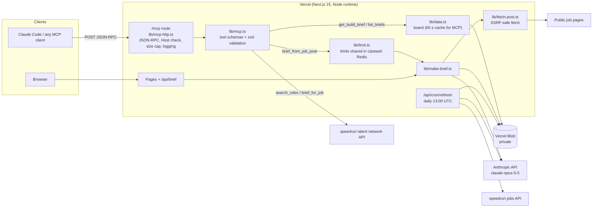

# One Link

AI made applying for jobs free, so a resume now says less than ever. A working thing still costs real effort, and it shows a founder how someone thinks.

One Link turns a job post into a weekend proof-of-work brief:

- the one thing to build that would get the hiring manager to reply
- a three-step weekend plan
- what makes it good, and how it falls flat
- the first line of the note to send with it

Each brief puts the role's age and pay first, so nobody spends a weekend on a listing that has gone quiet.

**Live:** https://one-link-eta.vercel.app · **Why it exists:** https://one-link-eta.vercel.app/why · **Code:** https://github.com/ahdithanu/one-link · **Case study:** [docs/fde-case-study.md](docs/fde-case-study.md) · **Audit:** [docs/audit.md](docs/audit.md)

> An independent concept. Not affiliated with or endorsed by a16z or speedrun.

## What's in it

| Page | What it does |
| --- | --- |
| `/` | Paste any job link or description and get a brief, pick a speedrun role with a brief ready, or search all ~23k roles on the talent network |
| `/r/<id>` | The ready-made brief for one speedrun portfolio role, quoting its job post word for word |
| `/j/<id>` | Any talent network role: its age, pay and location first, then a brief written the first time someone asks for one and saved for everyone after |
| `/b/<id>` | A shareable brief made from a pasted job |
| `/why` | Why it was built, what the board data showed, and live anonymous usage counts |
| `/founders` | A mock of what a founder would see (sample entries) |
| `/mcp` | An MCP server, so AI agents can fetch briefs |

## Architecture



- **Ready-made briefs.** A daily Vercel cron reads the public speedrun jobs API, writes briefs for up to 12 new roles, and saves the board to Blob. If Blob is unavailable, the app uses the bundled `data/roles.json` and `data/briefs.json`.
- **Briefs from a pasted job.** `lib/make-brief.ts` fetches the post if given a link, then asks Claude for a structured brief, validated with zod. The paste box and the MCP server share this code and the same limits.
- **Privacy.** Only the generated brief is saved, never the pasted post. Usage counts are one empty file per event, with nothing about the person.

## MCP server

A public, stateless MCP server over Streamable HTTP (JSON responses, no sessions, no SSE). It needs no key, and it supports protocol versions 2025-11-25, 2025-06-18, 2025-03-26 and 2024-11-05.

### Install in Claude Code

```bash
claude mcp add --transport http one-link https://one-link-eta.vercel.app/mcp
```

It pairs with the speedrun talent network's own MCP server. Both use the same job ids, so an agent can find a role with `search_jobs` and pass the id straight to `get_build_brief`:

```bash
claude mcp add --transport http speedrun-talent https://mcp.speedrun-talent-network.com/mcp
```

### Tools

| Tool | Input | Returns | Side effects |
| --- | --- | --- | --- |
| `get_build_brief` | `job`: UUID, 8-hex prefix, or job URL (8 to 300 characters) | Brief, role age, pay, location, warnings, apply link, shareable URL. `structuredContent: { role, brief, url }` | Records one anonymous usage event (capped per caller) |
| `list_briefs` | `q` (≤120 characters), `function` (enum), `limit` (1 to 50, default 20) | Matching open roles, newest first. `structuredContent: { total, roles[] }` | None |
| `search_roles` | `q` (≤120 characters), `function` (lowercase talent network function), `page` (0 to 200) | Live search over every open role on the talent network, 50 a page, each marked `has_brief`. `structuredContent: { total, page, has_more, roles[] }` | One cached call to the talent network API |
| `brief_for_job` | `job`: UUID, 8-hex prefix, or job URL | The role's brief, written from its listing if nobody has asked before, and a `/j/<id>` URL | An existing brief is free. A new one is one model call, counts toward 5 an hour per caller, and stops at the daily cap |
| `brief_from_job_post` | `job_post`: description or public `https` URL (12 to 20,000 characters; a pasted description needs at least 200) | A new brief and a shareable URL. Takes 10 to 30 seconds. | One model call. Saves the brief (never the post). 5 an hour per caller. |

Every tool declares an `outputSchema` (JSON Schema 2020-12) generated from the zod schemas in `lib/mcp-output.ts`, and tests check real results against it, so clients can validate `structuredContent`. Invalid arguments come back as tool errors (`isError: true`) with a message saying what to fix. An unknown tool is JSON-RPC -32602, and an unknown method is -32601.

### Protocol behavior

| Request | Response |
| --- | --- |
| Valid request | 200 with a JSON-RPC result |
| Notification, or a JSON-RPC response from the client | 202, empty body |
| Invalid JSON | 400, -32700 |
| Batch, missing `jsonrpc`, or null or non-scalar `id` | 400, -32600 |
| Unsupported `MCP-Protocol-Version` header | 400 |
| `Host` not served by this deployment (DNS rebinding) | 403 |
| Body over 64 KB | 413 |
| `GET` or `DELETE` (no stream, no sessions) | 405 |

## Evaluation

There are three layers, kept apart because they answer different questions.

1. **Tests** (`npm test`, 199 tests). Protocol handling, tool contracts, `makeBrief` and network-brief failure mapping with an injected model, fetcher and talent network, SSRF rules, rate limits, size caps, logging hygiene, and Host checks. No network or model.
2. **Deterministic tool eval** (`npm run eval:tools`). Every open role on the bundled board is run through the real tool handlers. It checks:
   - each id form resolves
   - output schema
   - that the brief served matches the stored source data
   - format rules: three days, title ≤8 words, evidence ≤15 words, a link slot in the opener, no em dashes
   - age and pay are shown
   - list filters match a direct count
   - limits
   - empty results
   - invalid parameters

   Results go to `eval/results/tools.json`.
3. **Model eval** (`npm run eval:model`, needs `ANTHROPIC_API_KEY`). It runs brief generation on a frozen dataset:
   - 11 real public speedrun posts across 9 functions
   - 4 adversarial cases: a non-job text, a prompt injection, a thin post, and a Spanish post

   It scores each output with deterministic checks: right outcome, company and title match, verbatim evidence, format rules, injected strings absent, and no numbers missing from the post. A separate model call then acts as a grounding judge: it lists claims the post doesn't support and rates relevance. The judge is a model too, so its numbers are an estimate, not ground truth. This eval is not in CI because it costs money.

### Measured results

| What | Result | Where measured |
| --- | --- | --- |
| Unit, protocol and security tests | 199 / 199 pass | Local, Node 26 |
| Deterministic tool eval | 2,426 / 2,426 checks pass over 195 open roles (21 check types) | Local, bundled board as of 2026-10-31 |
| HTTP smoke test | 13 / 13 | Local `next start` |
| Official MCP conformance suite | Every scenario that applies to a tools-only server passes (7). The other 24 test features this server doesn't offer. [Details](eval/results/conformance.md) | Local |
| MCP Inspector CLI | tools/list and tools/call work, and the error path is correct | Local |
| Model eval | **Not run yet.** The project key is a sensitive Vercel variable, so it can't be pulled. Run `npm run eval:model` with a key. | n/a |
| `npm audit --omit=dev` | 0 vulnerabilities (7 before) | Local |

Latency, from `npm run bench`: sequential requests, the first 3 discarded as warm-up.

| Operation | Local median / p95 (n=100) | Production before, `89e893a` (n=50) | Production after, `f2dd299` (n=50) |
| --- | --- | --- | --- |
| initialize | 2.0 / 2.5 ms | 128.5 / 167.0 ms | 97.0 / 143.3 ms |
| tools/list | 2.0 / 2.4 ms | 141.8 / 287.4 ms | 96.0 / 106.8 ms |
| list_briefs (default) | 2.1 / 3.0 ms | 282.2 / 418.7 ms | 95.1 / 111.7 ms |
| list_briefs (q filter) | 2.1 / 2.5 ms | 287.5 / 672.0 ms | 99.9 / 128.1 ms |
| get_build_brief | 1.9 / 2.2 ms | not measured (it writes a usage event) | not measured |

Local numbers are from a laptop calling `next start` over loopback with the bundled board and no Blob access, so they show handler cost only. Production numbers are from the same laptop to `one-link-eta.vercel.app`, so they include network round trips. "Before" is the pre-change deployment on 2026-11-19, which did an uncached Blob read on every tool call. "After" is this branch, deployed and measured on 2026-11-20. With the board cache (audit finding 18), `list_briefs` now costs the same as `initialize`, which reads no data. That puts the old gap at about 150 ms per call. `initialize` itself also dropped, which is most likely network variance between the two runs, so compare rows within a column rather than reading the drop as a server speedup. `brief_from_job_post` is dominated by the model call and isn't benchmarked here.

## Security decisions

- **Public, no auth.** Briefs are not sensitive, and agents should be able to use the server with zero setup. The one tool that costs money is rate-limited, and the Anthropic workspace spend cap is the hard ceiling.
- **SSRF.** Fetching is https only, on port 443, with no credentials in the URL. Every resolved address is checked against the IANA special-purpose ranges inside the socket's own DNS lookup, so DNS rebinding can't swap in a private IP. Up to 4 redirects, each re-checked. 8 s timeout. 1.5 MB streamed cap.
- **DNS rebinding against the MCP endpoint.** Requests are answered only when `Host` is a hostname the deployment serves: `localhost`, the Vercel deployment, branch and production URLs, and `MCP_ALLOWED_HOSTS`. Origin is not restricted because CORS is open by design.
- **Rate limits.**
  - 5 model briefs an hour per caller, and 60 an hour across all callers.
  - Briefs for network roles also stop at a daily cap (`DAILY_BRIEF_CAP`, default 100). A slot is reserved with an atomic Redis counter before the model call, and given back if the call fails. At roughly $0.03 to $0.06 a brief, that bounds this path to about $3 to $6 a day.
  - Network search: 600 an hour per caller, and identical searches are cached for 5 minutes.
  - 60 usage events an hour per caller, separately for agents and for pages.
  - With Upstash Redis configured, every limit holds across all instances. Each check is one atomic Lua script (a sliding-window log using the Redis server's clock, so instances agree on time). It uses only plain Redis commands, so the same code runs on Upstash and on a local Redis in tests. Callers are keyed by an HMAC of their IP, so raw IPs never reach Redis.
  - If Redis isn't configured, errors, or takes over 1.5 s, each limit falls back to a sliding window in that instance's memory (bounded at 10k callers), and the daily cap falls back to counting marker blobs. An outage weakens the limits but never removes them.
- **Input limits.** 64 KB request body. zod validation for every tool argument, done before any rate limit is used.
- **Prompt injection.** The job post is wrapped and labeled as untrusted data. Output is checked against a schema, and `evidence` is kept only if it appears in the post word for word.
- **Logs.** Each line holds the method, tool, request id, status, error category, duration and token usage. Never arguments, post text, IPs or keys (enforced by a test).
- **Dependencies.** Runtime dependencies are pinned to tested versions, and transitive advisories are fixed with npm `overrides`. CI fails on a high-severity advisory.

## Observability

Every MCP request writes one JSON line to stdout, which ends up in Vercel's runtime logs. Shape shown with illustrative values:

```json
{"ts":"2026-11-19T17:23:47.689Z","event":"mcp_request","request_id":"…","method":"tools/call","tool":"brief_from_job_post","ok":true,"status":200,"duration_ms":14210,"usage":{"model":"claude-opus-5-5","input_tokens":2130,"output_tokens":690}}
```

`error_category` is one of: `parse_error`, `invalid_request`, `unsupported_version`, `forbidden_host`, `payload_too_large`, `method_not_found`, `unknown_tool`, `invalid_arguments`, `not_found`, `rate_limited`, `fetch_failed`, `not_a_job_post`, `model_unavailable`, `model_rate_limited`, `model_error` or `internal`. Set `ONE_LINK_LOG=off` to silence it.

### Health

`GET /api/health` reports whether rate limits are global or per instance, whether Redis is reachable and its latency, today's brief budget use against the cap, and whether a model key is configured. It never includes secret values. A `degraded` list names anything running weaker than intended, so a fallback to per-instance limits is visible rather than silent. Results are cached for 15 seconds.

### Production monitor

`.github/workflows/monitor.yml` runs the read-only smoke test against production every 15 minutes, with `--live` so it also checks network search and the home page. It retries once after 30 seconds, and a failed run emails the repository owner. Nothing pages a phone yet, and GitHub pauses scheduled workflows in a public repository after 60 days without commits.

## Run it locally

Requires Node 20 or newer (CI uses Node 22).

```bash
npm install
```

```bash
npm run dev
```

The app runs at http://localhost:3210. Without any environment variables it still serves the bundled roles and briefs. Set these to turn on the rest:

| Variable | Used for |
| --- | --- |
| `ANTHROPIC_API_KEY` | Writing new briefs (paste box, `brief_from_job_post`, the daily refresh, the model eval) |
| `BLOB_READ_WRITE_TOKEN` | Saving briefs, the refreshed board, and usage counts |
| `CRON_SECRET` | Protecting `/api/cron/refresh` |
| `UPSTASH_REDIS_REST_URL`, `UPSTASH_REDIS_REST_TOKEN` | Shared rate limits and daily cap. Vercel's Upstash integration sets `KV_REST_API_URL` and `KV_REST_API_TOKEN` instead; either pair works. Without them, limits are per instance |
| `DAILY_BRIEF_CAP` | New network-role briefs allowed per UTC day across all instances (default 100) |
| `MCP_ALLOWED_HOSTS` | Extra hostnames the MCP endpoint answers for, comma-separated (for example a custom domain) |

### Reproduce the checks

```bash
npm run typecheck
```

```bash
npm run lint
```

```bash
npm test
```

```bash
npm run eval:tools
```

```bash
npm run build && npx next start -p 3210
```

Then, in a second terminal:

```bash
npm run smoke -- http://localhost:3210/mcp
```

Distributed limits and the brief lock, across separate processes against a real Redis (the same check CI runs):

```bash
docker network create onelink-test
docker run -d --name ol-redis --network onelink-test redis:7.4-alpine
docker run -d --name ol-srh --network onelink-test -p 8079:80 -e SRH_MODE=env -e SRH_TOKEN=local-test-token -e SRH_CONNECTION_STRING=redis://ol-redis:6379 hiett/serverless-redis-http:latest
ONE_LINK_TEST_REDIS=1 UPSTASH_REDIS_REST_URL=http://localhost:8079 UPSTASH_REDIS_REST_TOKEN=local-test-token npm run test:redis
```

```bash
npm run bench -- http://localhost:3210/mcp --n 100 --with-brief
```

```bash
npx @modelcontextprotocol/conformance@0.1.16 server --url http://localhost:3210/mcp --suite all
```

The model eval costs about 30 model calls. It writes `eval/results/model-<date>.json`:

```bash
ANTHROPIC_API_KEY=sk-ant-... npm run eval:model
```

To refresh the frozen eval dataset from the live board (paced to stay under the API's rate limit):

```bash
npx tsx eval/build-dataset.mts
```

GitHub Actions (`.github/workflows/ci.yml`) runs type check, lint, tests, the tool eval, a dependency audit, the production build, and the HTTP smoke test against the built app on every push to `main` and every pull request.

## Known limitations

- Rate limits and the daily cap are only global while Upstash Redis is reachable. During a Redis outage they fall back to per-instance limits, so the ceiling is the per-instance limit times the instance count until Redis is back.
- `x-real-ip` and `x-forwarded-for` are trusted. Vercel overwrites them, but behind any other proxy they're client-controlled.
- The model eval uses one run per case and a model judge. That's enough to catch regressions, not to claim a quality level.
- Ready-made briefs exist only for speedrun portfolio roles. Other talent network roles get a brief the first time someone asks (`/j/<id>`, `brief_for_job`), and jobs elsewhere go through `brief_from_job_post`.
- Network search depends on the talent network's public API. There is no local copy, because the API only pages through about 10,000 of its roles. If the API is down, search says so and speedrun briefs keep working.
- Pay for non-speedrun roles shows only what's posted. The speedrun pay bands aren't applied to other companies.
- Two requests for the same new brief share one model call across instances only while Redis is reachable (a `SET NX` lock per job, 90 s expiry, released only by its owner). Without Redis, requests on the same instance still share one call; requests on different instances can both write it.
- Finished work is saved in the person's browser. Nothing reaches a founder or speedrun.
- The founder queue uses made-up sample entries.
- No one at speedrun has seen or approved this.

## Stack

Next.js 15 (App Router) on Vercel, Vercel Blob, the Anthropic SDK, and zod. The MCP server is hand-written in `app/mcp/route.ts`, `lib/mcp-http.ts` and `lib/mcp.ts`, with no SDK dependency. Tests use `node:test` through `tsx`.
